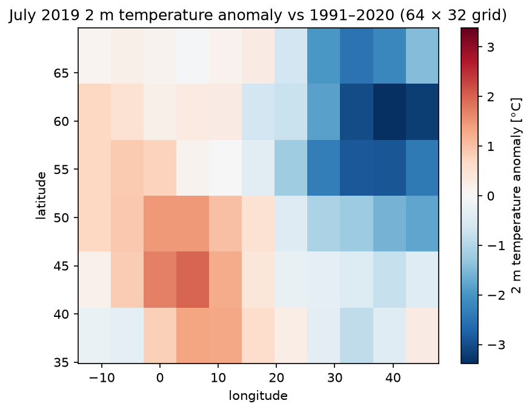

# Exploring ERA5 2 m temperature with xarray

A short analysis of ERA5 reanalysis data: global snapshots, time series, a climatology,
a long-term trend and a temperature anomaly map, using xarray, Dask and Zarr.

## Data

[ERA5](https://www.ecmwf.int/en/forecasts/dataset/ecmwf-reanalysis-v5) is ECMWF's global
reanalysis of the atmosphere. This project uses the
[WeatherBench 2](https://weatherbench2.readthedocs.io/) copy, regridded to a coarse 64 × 32 grid (5.625° in longitude, about 5.81° in latitude, including the poles), 6-hourly, covering 1959–2021, read directly from cloud storage as Zarr.

## Results



- **July 2019 anomaly:** warmer than the 1991–2020 normal over western and central
  Europe (up to about +2 °C around France), colder in the north-east (down to about −3 °C).
- **Long-term trend:** annual means in the Darmstadt grid cell rose by about +0.33 °C per
  decade over 1959–2021.
- **Seasonal cycle:** in 2020, Darmstadt's seasonal amplitude (17.6 °C) was about twice
  Reading's (8.3 °C), consistent with Reading's maritime climate.
- **2020 against the normal:** in the Darmstadt grid cell, 10 of 12 months were warmer
  than 1991–2020, most strongly February (+3.7 °C).

The full analysis, with explanations, is in
[`era5_exploration.ipynb`](era5_exploration.ipynb).

## Running it

Tested with Python 3.14.

```bash
python -m venv .venv
source .venv/bin/activate        # Windows: .venv\Scripts\activate
pip install -r requirements.txt
jupyter notebook era5_exploration.ipynb
```

The first run downloads data from public cloud storage (no account needed) and caches it
in `data/`. Later runs read the local copy.

## Limitations

- The 64 × 32 grid averages over regions several hundred kilometres wide, so results
  describe regions, not specific locations.
- Monthly means dilute short extremes such as heatwaves.
- The trend is a descriptive least-squares fit, without a significance test.
- The WeatherBench 2 store ends in 2021, despite "2022" in its name.

## Technical notes

- **Order of operations with lazy data:** selecting before transforming keeps the
  computation small; transforming the full dataset first builds a much larger task graph.
- **Chunk layout:** the store is chunked by time, so global maps for one time step are
  cheap, while long time series at one grid point require reading every chunk. Such
  series are cached locally as Zarr after the first download.
- **Writing Zarr from this source:** the variables carry encodings from the original
  Zarr v2 store; these are cleared before writing a local copy with zarr-python 3.